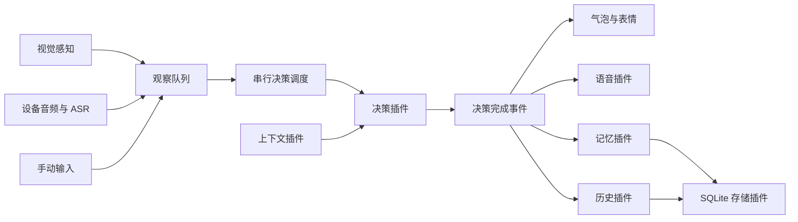

# My Live2D Pet

基于 Electron、TypeScript、PixiJS 和 Live2D Cubism 4 的桌宠。桌宠可以结合桌面画面、设备播放的语音和手动输入进行对话，并通过表情、气泡和 TTS 展示回复。

项目采用插件架构：核心负责窗口、消息总线、观察队列、决策调度和插件生命周期；感知、模型请求、语音、记忆及历史对话由插件实现。

## 功能

- 透明置顶窗口、拖动定位和鼠标视线跟随。
- 定时全屏截图与画面变化检测。
- 设备音频输出采集、语音分段和 ASR 转写，目前支持 Linux。
- 右键手动对话，支持纯文本输入。
- 手动播放模型支持的动作和表情。
- 系统 TTS 与 GPT-SoVITS，支持开关、串行播放和取消。
- 近期记忆、会话摘要、长期记忆，以及清空记忆菜单。
- SQLite 历史对话、分页与文字搜索。
- 插件菜单挂载、服务依赖排序和自动清理。

## 快速开始

### 1. 准备环境与模型

需要 Node.js **22.12 或更高版本**、npm 和可运行 Electron 的桌面环境。构建 SQLite 原生模块时可能需要 Python 和本机 C/C++ 编译工具。

模型资源放在 `assets/`。当前默认路径为：

```text
assets/
└── Setsuna_v081l_b/
    ├── setsuna_psd2live_v001.model3.json
    ├── icon.png
    └── 模型引用的 moc3、纹理、动作、表情等文件
```

`assets/` 被 Git 忽略，需要自行准备模型包。更换模型时，同时修改 [src/main.ts](src/main.ts) 的 `MODEL_URL` 和 [electron/live2dCatalog.js](electron/live2dCatalog.js) 的 `MODEL3_PATH`；检查默认动作组、点击动作和 `neutral` 表情是否存在。托盘图标路径在 [electron/main.js](electron/main.js) 中。

Live2D Cubism Core 脚本位于 `public/live2dcubismcore.min.js`，由 `index.html` 加载。

### 2. 安装依赖与配置

在项目根目录执行：

```bash
npm install
```

安装会自动重建 `better-sqlite3` 的 Electron 原生模块。首次配置时，将 [config.example.json](config.example.json) 复制为 `config.json`，修改模型接口和角色设定。已有配置可以继续使用。

`config.json` 被 Git 忽略。完整示例包含 GPT-SoVITS 路径，使用前需要替换；暂时不需要语音时，将 `tts.enabled` 设为 `false`。

下面是一份可作为起点的配置，替换接口地址、模型和 API key 后使用：

```json
{
  "ui": { "windowWidth": 380, "windowHeight": 560 },
  "decision": {
    "provider": "ai-conversation",
    "enabled": true,
    "interval_ms": 10000
  },
  "plugins": [
    { "name": "manual-input", "enabled": true },
    { "name": "storage-sqlite", "enabled": true },
    { "name": "dialogue-history", "enabled": true },
    {
      "name": "ai-conversation",
      "enabled": true,
      "ai": {
        "endpoint": "https://your-api.example.com/v1",
        "apiKey": "your-api-key",
        "model": "your-model",
        "max_tokens": 1024,
        "timeoutMs": 30000,
        "retryBudgetMs": 90000
      },
      "character": {
        "name": "Setsuna",
        "description": "你是陪伴用户的桌宠。",
        "personality": "温柔，表达自然简洁。",
        "rules": "根据用户输入和观察内容回复，通常只说一到两句话。",
        "language": "中文"
      }
    },
    {
      "name": "screen-perception",
      "enabled": true,
      "interval_ms": 5000,
      "observationTtlMs": 60000,
      "changeDetect": { "enabled": true, "hashSize": 8, "threshold": 4 }
    },
    { "name": "memory", "enabled": true }
  ]
}
```

AI 插件对接兼容 Chat Completions 的接口。启用视觉感知时，所选模型需要支持图片输入；只使用文字时，可以关闭视觉插件的自动采集。`ai.proxy` 可配置独立的模型请求代理。

### 3. 启动桌宠

```bash
npm start
```

此命令启动 Vite，并在 `127.0.0.1:5173` 就绪后启动 Electron。启动前会检查 SQLite 原生模块。

| 命令 | 用途 |
| --- | --- |
| `npm start` / `npm run desktop` | 启动桌宠开发环境 |
| `npm run dev` | 仅启动 Vite 页面 |
| `npm run build` | 构建前端到 `dist/` |
| `npm run preview` | 预览前端构建结果 |
| `npm run rebuild:native` | 强制重建 SQLite 原生模块 |
| `npm test` | 运行现有测试 |
| `npm run test:audio` | 运行音频相关测试 |

`build` 目前只构建前端，项目尚未配置 Electron 安装包或发布包生成流程。

## 使用方式

右键桌宠或打开托盘菜单：

| 操作 | 说明 |
| --- | --- |
| 显示到右下角 | 恢复桌宠并重新定位 |
| 手动对话… | 输入消息，Ctrl/Cmd+Enter 发送，Esc 关闭；最多 4000 个字符 |
| 截取全屏 | 手动保存主屏截图，不加入对话观察队列 |
| 历史对话 | 浏览并搜索已经完成的对话 |
| 感知设备播放的语音 → 开启/关闭 | 控制本次运行的音频采集，插件配置存在时显示 |
| 语音 TTS → 开启/关闭 | 控制本次运行的语音输出，TTS 插件启用时显示 |
| 记忆 → 清空全部记忆 | 清除近期记忆、摘要、长期事实和当前旧记忆文件；保留历史对话 |
| 播放动作 / 切换表情 | 按模型定义手动播放动作或表情 |

点击桌宠会请求处理已有观察；队列为空时跳过。手动输入会主动请求决策，当前决策忙碌时等待下一轮。

`decision.interval_ms` 控制自动决策间隔：负数或 `decision.enabled=false` 关闭自动决策，仍可手动触发；设为 `0` 时至少间隔 1 秒。视觉截图周期由插件的 `interval_ms` 独立控制，关闭自动截图后仍可手动保存截图。

画面不变不会阻止已有音频文字或手动消息参与决策。设备音频属于外部观察，手动输入属于用户直接说的话。

## 设备音频与本地 Whisper

音频插件采集设备**播放的声音**，使用 PulseAudio 或 PipeWire 的 PulseAudio 兼容输出监视源。Linux 需要 `pactl` 和 `parec`，通常由 `pulseaudio-utils` 提供：

```bash
sudo apt install pulseaudio-utils
```

### 启动 ASR 容器

[compose.asr.yaml](compose.asr.yaml) 使用本地已有的 `onerahmet/openai-whisper-asr-webservice:latest` 镜像，不自动拉取。已有镜像使用其它标签时，修改 Compose 的 `image` 字段，使其与本地标签一致。

```bash
docker compose -f compose.asr.yaml up -d
docker compose -f compose.asr.yaml logs -f
docker compose -f compose.asr.yaml ps
```

默认使用 `faster_whisper`、`small` 模型、CPU 和 `int8`，服务地址为 `http://127.0.0.1:9000`。首次启动仍需下载模型；缓存保存到 `mylive2dpet-whisper-cache` 卷。

模型下载默认使用 `https://hf-mirror.com`。如需使用官方地址：

```bash
WHISPER_HF_ENDPOINT=https://huggingface.co docker compose -f compose.asr.yaml up -d
```

### 配置音频插件

在 `plugins` 数组中加入：

```json
{
  "name": "audio-output-perception",
  "enabled": true,
  "source": "default",
  "speechThresholdDb": -40,
  "minSpeechMs": 400,
  "silenceMs": 800,
  "maxSegmentMs": 15000,
  "ttsCooldownMs": 600,
  "asr": {
    "provider": "whisper-asr-webservice",
    "endpoint": "http://127.0.0.1:9000",
    "language": "zh",
    "vadFilter": true,
    "timeoutMs": 60000
  }
}
```

插件通过 `/asr` 提交音频，转写结果打印到终端并加入观察队列。默认不保存原始音频；桌宠播放 TTS 时暂时抑制采集，减少自身语音被再次识别。

`source=default` 使用默认输出设备的 `.monitor` 源。可用 `pactl list short sources` 查看其它监视源并指定名称。`language` 留空可自动识别语言。ASR 也支持兼容 `/audio/transcriptions` 的接口，配置方式见 [架构文档](electron/architecture/README.md)。

## TTS

### 系统语音

在 `plugins` 中配置：

```json
{ "name": "tts", "enabled": true, "provider": "system", "interruptOnNewChat": true }
```

系统合成使用 Windows 的 `System.Speech`、macOS 的 `say`，或 Linux 的 `espeak-ng` / `espeak`。播放使用 Windows PowerShell、macOS `afplay` 或 Linux `aplay`。

Linux 示例依赖：

```bash
sudo apt install espeak-ng alsa-utils
```

### GPT-SoVITS

先在 GPT-SoVITS 项目中启动 API 服务，例如 `api_v2.py`，再配置插件：

```json
{
  "name": "tts",
  "enabled": true,
  "provider": "gpt-sovits",
  "apiBase": "http://127.0.0.1:9880",
  "apiVersion": "v2",
  "gptWeights": "assets/voice/model.ckpt",
  "sovitsWeights": "assets/voice/model.pth",
  "refAudio": "assets/voice/reference.wav",
  "promptText": "参考音频对应的台词。",
  "textLang": "zh",
  "promptLang": "zh",
  "interruptOnNewChat": true
}
```

模型和参考音频需自行准备。相对路径以本项目根目录为基准；本机 `refAudio` 必须存在。容器或远程服务看到的参考音频路径不同，可用 `refAudioApiPath` 指定服务端路径。服务已预加载权重时，可设 `weightsPreloaded=true`，跳过权重切换。

新语音默认取消旧任务。关闭 TTS 会取消待处理合成和播放；重新开启不会恢复已取消的语音。

## 记忆、历史与数据位置

记忆分为近期对话缓冲、滚动会话摘要和长期事实。近期缓冲和摘要保存在进程内；长期事实与历史对话由各自插件写入共享 SQLite。摘要和事实提取通过 AI 插件的文本服务后台执行。

| 数据 | 默认位置 |
| --- | --- |
| 配置 | 项目根目录 `config.json` |
| 长期记忆和历史对话 | Electron `userData/pet.sqlite3` |
| 自动截图 | `userData/cache/screen-perception/`，处理完成或丢弃后清理 |
| 手动保存截图 | 项目根目录 `logs/screenshots/` |
| AI 响应日志 | 项目根目录 `logs/openai.jsonl`，5 MiB 轮转，保留 3 个历史文件 |
| 旧数据导入来源 | `logs/memory.jsonl`、`logs/dialogue-history.jsonl` |

Linux 默认数据库通常位于 `~/.config/mylive2dpet/pet.sqlite3`，实际位置以启动日志中的 `database opened` 为准。数据库文件名可通过存储插件的 `path` 配置。

旧 JSONL 按来源路径一次性导入，之后新记录写入 SQLite。备份数据库时关闭应用，或使用 SQLite 备份机制，以包含 WAL 中的最新记录。

记忆和历史保存在本地。截图与转写文本会按配置发送给 AI 模型接口；使用本地 Whisper 只决定语音转写在哪里执行。

## 插件与架构



| 插件 | 职责 |
| --- | --- |
| `manual-input` | 输入窗口、文本验证、消息提交和菜单 |
| `screen-perception` | 截图周期、变化检测、观察与临时资源 |
| `audio-output-perception` | 输出音频采集、分段、ASR、去重和菜单 |
| `ai-conversation` | 模型请求、提示词、图片编码、结果解析及文本服务 |
| `tts` | 合成、播放、取消和运行期开关 |
| `memory` | 近期记忆、摘要、长期事实和清空能力 |
| `dialogue-history` | 历史记录、搜索、窗口和菜单 |
| `storage-sqlite` | 数据库连接、事务、迁移和旧文件导入 |

```text
electron/
├── main.js               # Electron 宿主与应用组装
├── pluginHost.js         # 插件生命周期与受控扩展接口
├── architecture/         # 契约、总线、观察队列、调度和服务注册
├── modules/              # 决策与输出连接
├── platform/             # 系统适配能力
└── plugins/              # 各能力的实现和专用窗口资源
src/                      # Live2D 渲染、交互与气泡
public/                   # Cubism Core
assets/                   # 本地模型与声线资源
```

插件通过静态 [manifest](electron/plugins/manifest.js) 注册，导出 `activate(context)` 并返回 `start`、`stop`、`dispose`。宿主提供菜单、IPC、窗口、感知入口、决策请求、上下文和通用服务接口；插件声明必需与可选服务，宿主按依赖排序加载。

详细契约、配置语义、生命周期和开发接口见 [electron/architecture/README.md](electron/architecture/README.md)。

## 配置生效与当前边界

- AI 请求参数、观察配额和后续决策间隔在后续读取配置时生效；插件启用、依赖、数据库路径及捕获定时器等更改建议重启应用。
- 配置格式错误时保留上次有效配置，终端会报告错误；首次启动仍需要有效配置文件。
- 设备音频捕获目前只实现 Linux PulseAudio/PipeWire 适配。
- 待处理观察和失败记录目前保存在内存，尚未实现手动消息的持久化收件箱与启动恢复。
- 默认模型路径和部分动作名称目前写在代码中；更换模型需要同步调整。
