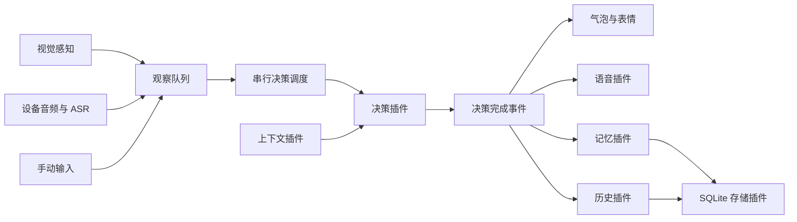

# My Live2D Pet

基于 Electron、TypeScript、PixiJS 和 Live2D Cubism 4 的桌宠。桌宠可以结合桌面画面、设备播放的语音和手动输入进行对话，并通过表情、气泡和 TTS 展示回复。

项目采用插件架构：核心负责窗口、消息总线、观察队列、决策调度和插件生命周期；感知、模型请求、语音、记忆及历史对话由插件实现。

## 功能

- 透明置顶窗口、拖动定位和鼠标视线跟随。
- 定时全屏截图与画面变化检测。
- 设备音频输出采集、语音分段和 ASR 转写，目前支持 Linux。
- 右键手动对话，支持纯文本输入。
- 手动播放模型支持的动作和表情。
- 系统 TTS 与 GPT-SoVITS，支持开关、串行播放和取消。
- 近期记忆、长期记忆，以及清空记忆菜单。
- 从飞书聊天、文档和会议转写积累人物画像，支持合理猜测、来源查看和手动修正。
- 选择题提问浮窗，支持补充、跳过、延后和今天暂停；支持查看提问与回答记录。
- SQLite 历史对话、分页与文字搜索。
- 插件菜单挂载、服务依赖排序和自动清理。

## 快速开始

### 1. 准备环境与模型

需要 Node.js **22.12 或更高版本**、npm 和可运行 Electron 的桌面环境。构建 SQLite 原生模块时可能需要 Python 和本机 C/C++ 编译工具。

模型资源放在 `assets/`。当前默认路径为：

```text
assets/
└── Setsuna_v081l_b/
    ├── setsuna_psd2live_v001.model3.json
    ├── icon.png
    └── 模型引用的 moc3、纹理、动作、表情等文件
```

`assets/` 被 Git 忽略，需要自行准备模型包。更换模型时，同时修改 [src/main.ts](src/main.ts) 的 `MODEL_URL` 和 [electron/live2dCatalog.js](electron/live2dCatalog.js) 的 `MODEL3_PATH`；检查默认动作组、点击动作和 `neutral` 表情是否存在。托盘图标路径在 [electron/main.js](electron/main.js) 中。

Live2D Cubism Core 脚本位于 `public/live2dcubismcore.min.js`，由 `index.html` 加载。

### 2. 安装依赖与配置

在项目根目录执行：

```bash
npm install
```

安装会自动重建 `better-sqlite3` 的 Electron 原生模块。首次配置时，将 [config.example.json](config.example.json) 复制为 `config.json`，修改模型接口和角色设定。配置仅支持当前插件格式，功能参数放在 `plugins` 中，决策调度放在 `decision` 中。

`config.json` 被 Git 忽略。示例默认关闭 TTS、开启设备语音监听。启用 TTS 时，将 `plugins` 中 `name=tts` 的 `enabled` 设为 `true`，并替换示例中的 GPT-SoVITS 路径。

下面是一份可作为起点的配置，替换接口地址、模型和 API key 后使用：

```json
{
  "ui": { "windowWidth": 380, "windowHeight": 560 },
  "decision": {
    "provider": "ai-conversation",
    "enabled": true,
    "interval_ms": 10000
  },
  "plugins": [
    { "name": "manual-input", "enabled": true },
    { "name": "storage-sqlite", "enabled": true },
    { "name": "dialogue-history", "enabled": true },
    {
      "name": "ai-conversation",
      "enabled": true,
      "ai": {
        "endpoint": "https://your-api.example.com/v1",
        "apiKey": "your-api-key",
        "model": "your-model",
        "max_tokens": 1024,
        "timeoutMs": 120000,
        "retryBudgetMs": 360000
      },
      "character": {
        "name": "Setsuna",
        "description": "你是陪伴用户的桌宠。",
        "personality": "温柔，表达自然简洁。",
        "rules": "根据用户输入和观察内容回复，通常只说一到两句话。",
        "language": "中文"
      }
    },
    {
      "name": "screen-perception",
      "enabled": true,
      "interval_ms": 5000,
      "observationTtlMs": 60000,
      "changeDetect": { "enabled": true, "hashSize": 8, "threshold": 4 }
    },
    { "name": "memory", "enabled": true, "work": { "enabled": true } },
    { "name": "questions", "enabled": true }
  ]
}
```

AI 插件对接兼容 Chat Completions 的接口。启用视觉感知时，所选模型需要支持图片输入；只使用文字时，可以关闭视觉插件的自动采集。AI 插件的 `ai.proxy` 可配置独立的模型请求代理。

### 3. 启动桌宠

```bash
npm start
```

此命令启动 Vite，并在 `127.0.0.1:5173` 就绪后启动 Electron。启动前会检查 SQLite 原生模块。

| 命令 | 用途 |
| --- | --- |
| `npm start` / `npm run desktop` | 启动桌宠开发环境 |
| `npm run dev` | 仅启动 Vite 页面 |
| `npm run build` | 构建前端到 `dist/` |
| `npm run preview` | 预览前端构建结果 |
| `npm run rebuild:native` | 强制重建 SQLite 原生模块 |
| `npm test` | 运行现有测试 |
| `npm run test:audio` | 运行音频相关测试 |

`build` 目前只构建前端，项目尚未配置 Electron 安装包或发布包生成流程。

## 使用方式

右键桌宠或打开托盘菜单：

| 操作 | 说明 |
| --- | --- |
| 显示到右下角 | 恢复桌宠并重新定位 |
| 手动对话… | 输入消息，Ctrl/Cmd+Enter 发送，Esc 关闭；最多 4000 个字符 |
| 历史对话 | 浏览并搜索已经完成的对话 |
| 感知设备播放的语音 → 开启/关闭 | 控制本次运行的音频采集，插件配置存在时显示 |
| 感知设备播放的语音 → 实时显示内容 → 开启/关闭 | 在屏幕右上角显示监听状态和最近识别的语音文字 |
| 语音 TTS → 开启/关闭 | 控制本次运行的语音输出，TTS 插件启用时显示 |
| 记忆 → 查看当前记忆… | 查看近期对话、长期记忆和人物画像；画像可修正并展开信息来源，待提问统一放在提问记录页 |
| 记忆 → 查看提问记录… | 查看问过的问题、选项、每次提问时间、回答、跳过和延后；支持搜索及状态筛选 |
| 记忆 → 整理 | 手动通过 AI 整理长期事实及人物画像，合并重复信息、归档无价值内容；完成后显示统计，原始记录保留 |
| 记忆 → 清空全部记忆 | 二次确认后清除近期记忆、长期事实、人物画像、证据和提问记录；保留历史对话 |
| 桌宠提问 → 回答一个问题… | 主动打开一个尚未处理且未延后的选择题 |
| 桌宠提问 → 今天暂停自动提问 | 暂停至当天结束，重启保留，可随时恢复 |
| 播放动作 / 切换表情 | 按模型定义手动播放动作或表情 |

点击桌宠会请求处理已有观察；队列为空时跳过。手动输入会主动请求决策，当前决策忙碌时等待下一轮。

`decision.interval_ms` 控制自动决策间隔：负数或 `decision.enabled=false` 关闭自动决策，仍可手动触发；设为 `0` 时至少间隔 1 秒。视觉截图周期由插件的 `interval_ms` 独立控制，关闭自动截图后仍可手动保存截图。

画面不变不会阻止已有音频文字或手动消息参与决策。设备音频属于外部观察，手动输入属于用户直接说的话。

## 设备音频与本地 FunASR

音频插件采集设备**播放的声音**，使用 PulseAudio 或 PipeWire 的 PulseAudio 兼容输出监视源。Linux 需要 `pactl` 和 `parec`，通常由 `pulseaudio-utils` 提供：

```bash
sudo apt install pulseaudio-utils
```

### 启动 ASR 容器

[compose.asr.yaml](compose.asr.yaml) 使用 FunASR 官方 CPU 在线服务镜像，运行 Paraformer 的 **2-pass** 模式：在线模型边听边出字，离线模型在语音结束后修正文字并补标点。

```bash
docker compose -f compose.asr.yaml up -d
docker compose -f compose.asr.yaml logs -f
docker compose -f compose.asr.yaml ps
```

服务地址为 `ws://127.0.0.1:10096`，仅绑定本机。首次启动需要下载镜像以及中文在线、离线、VAD、标点、语言模型和 ITN 模型；模型缓存保存在 `mylive2dpet-funasr-models` 卷。等待日志显示模型加载完成、容器变为 healthy 后再开启监听。CPU 性能决定实际识别延迟；默认使用 4 个解码线程。

### 配置音频插件

在 `plugins` 数组中加入：

```json
{
  "name": "audio-output-perception",
  "enabled": true,
  "source": "default",
  "speechThresholdDb": -40,
  "minSpeechMs": 400,
  "silenceMs": 800,
  "maxSegmentMs": 15000,
  "ttsCooldownMs": 600,
  "asr": {
    "provider": "funasr",
    "endpoint": "ws://127.0.0.1:10096",
    "language": "zh",
    "chunkSize": [5, 10, 5],
    "chunkInterval": 10,
    "timeoutMs": 60000
  }
}
```

确认累计 400ms 语音后，插件开始通过 WebSocket 发送 16kHz 单声道 PCM16，保留开头的预录音；后续每 60ms 发送一块，不等整段结束。`chunkSize=[5,10,5]` 对应 600ms 在线解码窗口，每块大小由 `60 × chunkSize[1] / chunkInterval` 毫秒计算。静音 800ms 或达到 15 秒后发送结束标记，等待最终结果。`timeoutMs` 控制连接和段尾最终识别等待时间。

菜单「感知设备播放的语音 → 实时显示内容 → 开启」打开字幕窗口。流式文字标记为“识别中”，后续离线修正替换同一条字幕；只有段尾最终修正文本进入观察队列，按决策周期供桌宠理解和回应。中间字幕不会触发模型调用。默认不保存原始音频，桌宠播放 TTS 时会取消尚未完成的识别并暂时抑制采集。

`source=default` 使用默认输出设备的 `.monitor` 源，可用 `pactl list short sources` 查看其它监视源并指定名称。这是设备播放音频监听；采集器不会退回麦克风。当前容器模型主要面向中文，`language` 仅标记结果语言，切换识别语言需要更换服务端模型。`apiKey` 可用于需要 Bearer 验证的 WebSocket 网关；`proxy` 可填写 HTTP(S) 代理 URL，留空直连本地服务。

### 使用原有 Whisper 或其他转写服务

原有 Whisper 部署保存在 [compose.whisper.yaml](compose.whisper.yaml)，可运行 `docker compose -f compose.whisper.yaml up -d`，将 `asr.provider` 改回 `whisper-asr-webservice`、`endpoint` 改为 `http://127.0.0.1:9000`。该方式在分段完成后通过 HTTP `/asr` 转写，不提供流式字幕。

也支持兼容 `/audio/transcriptions` 的服务，配置 `provider=openai` 和 `model`，详见 [架构文档](electron/architecture/README.md)。修改配置后重启应用生效。

## TTS

### 系统语音

在 `plugins` 中配置：

```json
{ "name": "tts", "enabled": true, "provider": "system", "interruptOnNewChat": true }
```

系统合成使用 Windows 的 `System.Speech`、macOS 的 `say`，或 Linux 的 `espeak-ng` / `espeak`。播放使用 Windows PowerShell、macOS `afplay` 或 Linux `aplay`。

Linux 示例依赖：

```bash
sudo apt install espeak-ng alsa-utils
```

### GPT-SoVITS

先在 GPT-SoVITS 项目中启动 API 服务，例如 `api_v2.py`，再配置插件：

```json
{
  "name": "tts",
  "enabled": true,
  "provider": "gpt-sovits",
  "apiBase": "http://127.0.0.1:9880",
  "apiVersion": "v2",
  "gptWeights": "assets/voice/model.ckpt",
  "sovitsWeights": "assets/voice/model.pth",
  "refAudio": "assets/voice/reference.wav",
  "promptText": "参考音频对应的台词。",
  "textLang": "zh",
  "promptLang": "zh",
  "interruptOnNewChat": true
}
```

模型和参考音频需自行准备。相对路径以本项目根目录为基准；本机 `refAudio` 必须存在。容器或远程服务看到的参考音频路径不同，可用 `refAudioApiPath` 指定服务端路径。服务已预加载权重时，可设 `weightsPreloaded=true`，跳过权重切换。

新语音默认取消旧任务。关闭 TTS 会取消待处理合成和播放；重新开启不会恢复已取消的语音。

## 记忆、历史与数据位置

记忆包括近期对话、长期记忆及人物画像。近期对话保存在进程内；待更新完整对话、长期记忆、人物画像与历史对话由插件写入共享 SQLite。整理通过 AI 文本服务后台执行；格式错误保留待处理内容供后续重试。

「记忆 → 整理」手动整理已保存的长期事实和当前人物画像，并更新项目状态与经验，合并重复或互补内容，归档明显一次性或明确失效的临时事项。稳定身份、偏好与重要事实保留，矛盾信息没有明确变化依据时分别保留。画像合并限同一对象、同一字段，等价项目范围可以合并，不混合全局与项目画像；用户确认的内容和范围不能改写或归档，猜测不能升级为已观察内容。整理与后台更新／画像提取串行执行；请求失败、格式错误或事实／画像发生变化时都不写入结果，可再次点击重试。完成后分别显示长期事实和画像的整理前后条数、合并组数和归档条数；「查看当前记忆」的长期记忆页和人物画像页可展开整理记录，查看原始内容、原因和时间，来源证据与历史版本保留，记录重启保留，清空全部记忆时一并删除。启用长期记忆、人物画像或项目经验任一类别均可使用该手动入口，需提供 AI 文本服务。

手动整理一次提交全部已启用的长期事实及当前人物画像，不分批，也不按条数或字符预算拆分。发送事实内容、标签、重要性和时间，以及画像对象、字段、范围、内容、确认依据和时间，来源元数据留在本地。输出预算 `max_tokens=16384`，单次请求超时 5 分钟、含重试总预算 605 秒，最多重试一次；手动整理使用固定预算；自动长期记忆更新的输出预算由 `memory.longTerm.maxTokens` 配置，超时与重试预算相同。事实和画像在同一数据库事务中统一保存，失败保留原始记忆。

手动整理完成后通过桌宠聊天气泡显示长期事实和人物画像的整理前后条数、合并与归档数量；没有记忆或整理失败也使用气泡提示。通知不需要点击确认，只展示文字，不触发语音和新的记忆提取；停止插件或清空后的迟到结果不会再显示通知。

长期事实整理以明确的项目、功能模块或人物为单位归组，允许同一对象的多个相关子主题一次归并为分段记忆，每组不限来源条数。优先形成项目整体记忆，将功能、业务规则、技术约束、职责分工、决策和进展组织在一起；关键事实无法在1600字内保留时再按模块拆分。同一人物的身份、职责、偏好与互动关系也可归成一条长期记忆；人物画像仍遵守原有字段、范围与用户确认约束。正文明确对象名称，按子主题分段，保留关键术语与检索标签。删除重复表述和被最终结论覆盖的中间过程，保留关键约束、未解决事项与有依据的状态变化；不同对象、无关模块和无法解释的冲突分别保留，不强求固定压缩比例。合并正文上限为1600字，来源记忆、决策、会话、观察证据及画像标识随多次合并累计保留，原始记录仍可在整理历史中查看。

长期记忆自动更新采用较高添加门槛：默认每完成20次非静默对话，将这批完整对话、暂存的原始来源和全部现有长期记忆一起交给模型，优先保留原ID修改、补充对应条目；没有合适旧条目时，只有明确且跨会话仍有价值的信息才新增，新增重要性至少为4。普通聊天、临时进度、画面描述、细碎技术过程、猜测和宠物自己的说法不新增。无需修改时返回 `{"update":[],"add":[]}`，按正常完成处理；自动更新不删除或归档旧记忆。

会话摘要功能已移除，旧 `memory.summary` 配置会被忽略，旧数据库的摘要会在启动迁移时清理。待更新对话与来源独立存入 SQLite，不受近期对话容量、过期时间影响，重启后继续累积。更新及本批队列消费在同一事务中提交，失败保留旧记忆和全部待处理内容；请求期间新到的对话留到下一批。每批成功后重新累积20次对话；失败时，下个对话或恢复时重新评估保留的内容。配置键 `memory.longTerm.extractEveryNTurns` 保留兼容，现在表示更新间隔。查看窗口显示更新间隔、待更新轮数与已有条目的更新时间，更新前内容保存在整理历史中。

长期记忆更新默认16384 token（`memory.longTerm.maxTokens`），预算也可能包含模型推理所用的 token。长期更新单次超时5分钟、含重试总预算605秒，最多重试一次。文本接口若返回空正文或 `finish_reason=length`，拒绝保存不完整结果，保留待处理内容；错误日志包含模型、结束原因和 token 使用量。

项目状态与经验记忆由 `memory.practice.enabled` 控制，示例配置默认开启，已有配置可显式添加该开关。菜单「记忆 → 查看当前记忆」新增「项目状态」和「经验记忆」两页。项目记录明确名称与范围、目标、已完成事项、待验证／未完成事项、阻塞、下一步及最后来源时间；默认 7 天没有新来源时标注“久未更新”，供模型先确认当前进展，不自动宣称项目已完成或失效。

经验记录适用条件、处理方法、结果与验证状态，区分“尝试过，未验证”“已有验证来源”和“失败记录”。验证与失败必须引用本批来源的逐字摘录；没有结果证据时只能保留为尝试，宠物自己的回答不能作为成功证据。信息来源来自直接用户输入、设备音频原文和有截图关联的画面观察摘要，画面摘要仍标注为观察内容。来源是否足以支持结论由模型判断，逐字引用与来源校验不能替代实际运行验证。

项目与经验在共享 SQLite 中单独保存，不混入人物画像或稳定长期事实。默认累计 3 条来源或最早来源等待 2 分钟后，在串行后台维护任务中更新，即使桌宠静默也可触发；每 30 秒检查一次等待时间。`extractEveryNObservations`、`flushAfterMs`、`maxTokens`、`maxInject`、`staleAfterMs` 均可在 `memory.practice` 配置。提取只使用本批原始来源与现有项目／经验；来源、未处理队列及更新前历史重启后保留。失败或格式错误保留队列，请求期间的新来源留到下一次。项目与经验根据当前问题及近期对话检索，每类最多注入 `maxInject` 条；未验证经验与久未更新的项目在模型上下文中明确标记。

手动「整理」仍一次提交所有启用类别的当前记忆，以及项目／经验待处理来源，不拆分请求；旧事实／画像整理和新项目／经验计划在同一事务中提交，任一类别验证失败都不保存本次整理结果。新页可展开来源原文和之前的状态，清空全部记忆时一并清除项目、经验、来源及历史。关闭 `practice.enabled` 停止采集、自动更新与上下文注入，已保存记录仍可查看。

人物画像主要保存用户的身份、稳定职责、习惯、兴趣、偏好、沟通方式，以及亲友、同事、常联系的人与用户的关系和相处方式。项目和团队归属作为人物信息保存，具体任务、进展、技术细节、会议结论与待办通过近期对话和待更新来源保留，达到20轮对话门槛后统一评估是否更新长期记忆。观察整理返回人物关系，并在事务中写入；原始来源先暂存到长期记忆更新队列，每20次对话统一评估，不即时新增长期条目。无效来源或保存失败保留待处理观察。关系按人物、字段和范围更新，旧版本保留；区分「暂时猜测」「观察记录」和「用户回答」。用户回答或手动修正直接更新画像，自动猜测不能覆盖。别名作为关联线索保存，不仅凭同名自动合并人物。

人物画像页只展示人物信息、修正入口、可展开的信息来源及整理历史，不再单列最近观察或待提问。信息来源显示对应用户对话、提问回答、手动修正以及画面／音频内容与时间；后台原始线索保留用于提取与追溯。提问记录页同时展示未问过的待提问和已有记录，待提问优先显示，支持统一搜索、状态筛选和删除。

旧画像中的 task、项目／团队对象，以及明确的一次性技术讨论会迁入长期记忆，当前画像中的原记录归档；内容、用户确认依据和来源证据保留。启用人物画像和长期记忆后，启动会执行这项清理，迁移可重复执行。配置键 `memory.work` 和数据库表名保留兼容旧配置与数据。

提问优先补全用户本人的长期画像，包括职责、团队角色、工作习惯、兴趣与工具偏好、沟通方式。生成问题时优先提供用户画像上下文；待提问队列先选择用户的稳定画像问题，再选择与用户有关的人际关系和同事问题，同类仍按原有优先级排序。仅根据观察线索和未确认的画像缺口提问；已确认的字段不重复询问，没有合适问题时不强行生成。延后、闲置和语音等时机限制继续生效。

会议／播放转写在进入观察队列时保存原文、时间和转写元数据；截图通过模型的 `workSummary` 保留聊天作者、文档分工、项目和任务线索，携带对应观察 ID。宠物台词不作为人物画像证据。每 3 条观察或最早待处理观察达到 2 分钟时开始整理，单批最多 16 条。待整理内容和问题队列重启后继续保留。模型可以在纯观察回合返回 `shouldSpeak=false`，安静记录画面内容并更新画像；直接用户输入仍需回应。

提问插件需同时启用 `memory.work.enabled` 与 `questions.enabled`。问题来自工作记忆整理，单次只展示一个，提供 2～4 个选项、自由补充、不清楚、跳过和稍后再问。自动浮窗使用 `showInactive`，不抢输入焦点；当前默认不设每日次数上限或两次提问间隔（`dailyLimit=0`、`cooldownMs=0`），仍仅在用户闲置 8～300 秒、没有决策或 TTS、近期无系统语音和会议线索时弹出。会议线索与静默窗口是启发式判断，不是精确的会议状态识别。自动浮窗仅在 90 秒内未操作时延后；窗口获得焦点、点击或输入后取消超时，手动打开不设超时。已显示的问题不会因后台决策、语音或新消息关闭。重复跳过 3 次停止询问该问题；单个问题的「稍后再问」默认延后 30 分钟。手动入口可以绕过自动时机，但仍尊重问题的延后时间。需要恢复频率控制时，可将 `dailyLimit`、`cooldownMs` 设置为正数。

提问窗口的「移除该问题」会关闭窗口，删除当前问题及其已有提问记录；不保存答案或草稿，不更新画像。删除后该问题不再出现在待提问和提问记录中，重启后也不会恢复。

「记忆 → 查看提问记录…」直接打开记忆窗口的「提问记录」页。页面显示问过的问题、当时的选项、每次展示及回答／跳过／延后时间；可以按问题、人物、项目或回答搜索，并按当前状态筛选。已保存的旧回答也可查看；旧版本未保存的逐次展示时间无法补回，只显示原有的最后提问时间。记录重启保留，清空全部记忆时一并删除。

提问记录中的「删除答案」移除单条答案记录，「删除问题及记录」移除整个问题及其展示、回答、跳过和延后记录。删除成功后刷新列表；已确认的人物画像保留，历史删除不会撤销画像。

示例与当前配置已启用工作记忆和提问。参数见 [config.example.json](config.example.json) 的 `memory.work` 和 `questions`。已有配置未设置 `work.enabled=true` 时保持原有记忆行为；修改插件启用状态后重启。

| 数据 | 默认位置 |
| --- | --- |
| 配置 | 项目根目录 `config.json` |
| 长期记忆、人物画像、证据、提问记录和历史对话 | Electron `userData/pet.sqlite3` |
| 自动截图 | `userData/cache/screen-perception/`，处理完成或丢弃后清理 |
| 手动保存截图 | 项目根目录 `logs/screenshots/` |
| AI 响应日志 | 项目根目录 `logs/openai.jsonl`，5 MiB 轮转，保留 3 个历史文件 |
| 旧数据导入来源 | `logs/memory.jsonl`、`logs/dialogue-history.jsonl` |

Linux 默认数据库通常位于 `~/.config/mylive2dpet/pet.sqlite3`，实际位置以启动日志中的 `database opened` 为准。数据库文件名可通过存储插件的 `path` 配置。

旧 JSONL 按来源路径一次性导入，之后新记录写入 SQLite。备份数据库时关闭应用，或使用 SQLite 备份机制，以包含 WAL 中的最新记录。

记忆和历史保存在本地。截图与转写文本会按配置发送给 AI 模型接口；使用本地 FunASR 或 Whisper 只决定语音转写在哪里执行。

## 插件与架构



| 插件 | 职责 |
| --- | --- |
| `manual-input` | 输入窗口、文本验证、消息提交和菜单 |
| `screen-perception` | 截图周期、变化检测、观察与临时资源 |
| `audio-output-perception` | 输出音频采集、分段、ASR、去重和菜单 |
| `ai-conversation` | 模型请求、提示词、图片编码、结果解析及文本服务 |
| `tts` | 合成、播放、取消和运行期开关 |
| `memory` | 近期记忆、长期事实、人物画像、证据和清空能力 |
| `questions` | 选择题队列调度、浮窗与回答回写 |
| `dialogue-history` | 历史记录、搜索、窗口和菜单 |
| `raw-log` | 原始模型请求、返回结果、聊天形式查看窗口 |
| `storage-sqlite` | 数据库连接、事务、迁移和旧文件导入 |

右键菜单的「原始日志…」可查看每次发送给 OpenAI 兼容聊天接口的完整消息：系统提示词、用户/感知输入、实际发送的图片，以及返回内容或失败原因。请求按应用运行会话分组，包含文本/记忆整理请求和每次重试，窗口每 2 秒更新。每次请求的列表和详情展示接口实际返回的输入、输出、总 token、输入缓存命中及未命中数量；未命中默认由输入总量减缓存命中计算，兼容接口直接上报的命中／未命中字段。接口提供时另显示缓存写入及输出中的推理 token，它们不会额外计入总量。未上报字段显示“未提供”，不估算为0；已有原始响应中的 usage 也可直接展示，无需重新发送请求。记录写入现有 `pet.sqlite3` 的 `ai_requests` 表，重启后保留；不记录请求头或 API key。关闭窗口不会停止记录，设置插件 `raw-log.enabled=false` 可关闭功能。旧响应日志没有原始请求，窗口只显示新增记录。

```text
electron/
├── main.js               # Electron 宿主与应用组装
├── pluginHost.js         # 插件生命周期与受控扩展接口
├── architecture/         # 契约、总线、观察队列、调度和服务注册
├── modules/              # 决策与输出连接
├── platform/             # 系统适配能力
└── plugins/              # 各能力的实现和专用窗口资源
src/                      # Live2D 渲染、交互与气泡
public/                   # Cubism Core
assets/                   # 本地模型与声线资源
```

插件通过静态 [manifest](electron/plugins/manifest.js) 注册，导出 `activate(context)` 并返回 `start`、`stop`、`dispose`。宿主提供菜单、IPC、窗口、感知入口、决策请求、上下文和通用服务接口；插件声明必需与可选服务，宿主按依赖排序加载。

详细契约、配置语义、生命周期和开发接口见 [electron/architecture/README.md](electron/architecture/README.md)。

## 配置生效与当前边界

- AI 请求参数、观察配额和后续决策间隔在后续读取配置时生效；插件启用、依赖、数据库路径及捕获定时器等更改建议重启应用。
- 配置格式错误时保留上次有效配置，终端会报告错误；首次启动仍需要有效配置文件。
- 设备音频捕获目前只实现 Linux PulseAudio/PipeWire 适配。
- 待处理观察和失败记录目前保存在内存，尚未实现手动消息的持久化收件箱与启动恢复。
- 默认模型路径和部分动作名称目前写在代码中；更换模型需要同步调整。
