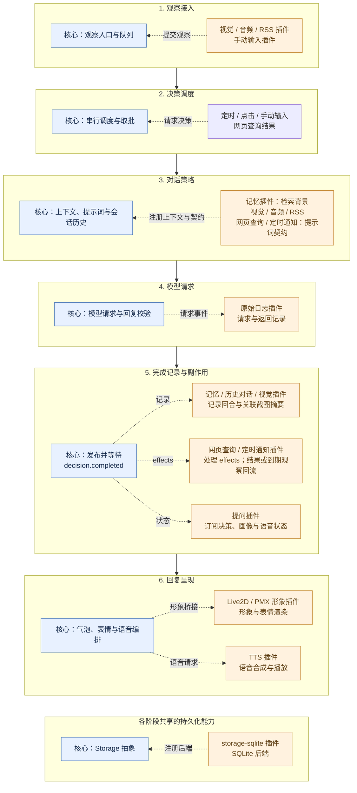

# My Live2D Pet

基于 Electron、TypeScript 的桌宠，支持 Live2D Cubism 4（`.model3.json`）和 PMX（MMD）格式的 3D 模型。核心负责窗口、观察队列、决策调度、对话策略、模型请求、Storage 抽象和插件生命周期，感知、记忆与输出能力通过插件扩展。

## 功能

- 透明置顶窗口、拖动定位、视线跟随，以及模型动作和表情。
- 手动文字对话，结合桌面截图、设备播放语音和 RSS 更新理解当前情境。
- 近期与长期记忆、人物画像、项目状态与经验，以及画像补充提问。
- 气泡与 TTS 回复、网页查询、单次定时通知。
- 历史对话搜索、模型请求与截图日志查看。

## 快速开始

需要 Node.js **22.12 或更高版本**、npm 和可运行 Electron 的桌面环境。构建 SQLite 原生模块可能需要 Python 和本机 C/C++ 编译工具。

```bash
npm install
cp config.example.json config.json
```

编辑 `config.json`，填写模型接口、API key 和角色设定，并将自行准备的形象资源放入 `assets/`。Live2D 和 3D 的资源路径、大小及动作配置分别见 [Live2D 插件](electron/plugins/avatarLive2d/README.md) 和 [3D 插件](electron/plugins/avatar3d/README.md)；同时只启用一个形象插件。

下面是仅使用手动文字对话的起点配置。模型路径和默认表情需按实际资源修改；完整示例见 [config.example.json](config.example.json)。

```json
{
  "conversation": {
    "enabled": true,
    "ai": {
      "endpoint": "https://your-api.example.com/v1",
      "apiKey": "your-api-key",
      "model": "your-model"
    },
    "character": {
      "name": "桌宠",
      "description": "你是陪伴用户的桌宠。",
      "language": "中文"
    }
  },
  "decision": {
    "enabled": true,
    "interval_ms": 10000
  },
  "plugins": [
    {
      "name": "avatar-live2d",
      "enabled": true,
      "modelPath": "assets/live2d/model.model3.json",
      "iconPath": "",
      "defaultExpression": "neutral",
      "idleMotion": null,
      "clickMotion": null
    },
    {
      "name": "manual-input",
      "enabled": true
    },
    {
      "name": "screen-perception",
      "enabled": false
    }
  ]
}
```

```bash
npm start
```

`npm start` 启动 Vite 与 Electron，并检查 SQLite 原生模块。右键桌宠或打开托盘菜单可手动对话、控制形象及使用已加载插件。点击桌宠会请求处理已有观察，队列为空时跳过。

`config.json` 与 `assets/` 被 Git 忽略。示例配置中的外部服务和声线资源需按本机环境调整；音频、TTS 等插件的部署步骤见各插件文档。

## 配置项

| 配置节点 | 用途 |
| --- | --- |
| `conversation.enabled` | 控制核心对话和共享文本生成 |
| `conversation.ai` | 模型接口、API key、模型名、代理、输出格式、请求预算 |
| `conversation.character` | 桌宠名称、角色描述、性格、规则和语言 |
| `conversation.history` | 会话轮数、输入预算、保留轮数与摘要预算 |
| `decision.enabled` / `interval_ms` | 自动决策开关与间隔；关闭后仍可手动触发 |
| `observations` | 观察队列容量、每批数量、重试次数与来源配额 |
| `ui` | 窗口宽度与高度 |
| `plugins` | 插件名称、启用状态及专属配置 |

核心模型对接兼容 Chat Completions 的接口；启用视觉感知时需支持图片输入。接口与回复校验见 [核心对话文档](electron/conversation/README.md)。

应用监听 `config.json`，校验通过后自动应用配置，并按依赖关系重载变化的插件；配置无效时继续使用上次有效配置。修改主进程源码后需要完全退出并重新启动应用。配置语义和开发接口见 [架构文档](electron/architecture/README.md)。

## 插件概览

[插件目录](electron/plugins/manifest.js) 注册了 **14 个主进程插件**。插件条目放在 `plugins` 数组中，使用 `name` 标识插件、`enabled` 控制启用；具体加载条件、依赖、配置示例和使用说明见下表链接。

| 插件 | 功能 | 主要配置项 |
| --- | --- | --- |
| [`manual-input`](electron/plugins/manualInput/README.md) | 手动文字对话 | `enabled` |
| [`avatar-live2d`](electron/plugins/avatarLive2d/README.md) | Live2D Cubism 4 形象 | `modelPath`、`scale`、动作与表情 |
| [`avatar-3d`](electron/plugins/avatar3d/README.md) | PMX 格式 3D 形象 | `modelPath`、`rotationY`、`physicsEnabled` |
| [`screen-perception`](electron/plugins/screenPerception/README.md) | 全屏截图与变化感知 | `interval_ms`、`changeDetect`、`observationTtlMs` |
| [`audio-output-perception`](electron/plugins/audioOutputPerception/README.md) | 设备播放语音转写（Linux） | `source`、分段参数、`asr` |
| [`rss`](electron/plugins/rss/README.md) | RSS / Atom 更新感知 | `feeds`、`interval_ms`、`emitOnFirstFetch` |
| [`web-search`](electron/plugins/webSearch/README.md) | 网页搜索与正文读取 | `searchProvider`、`fetchProvider`、`providers` |
| [`schedule`](electron/plugins/schedule/README.md) | 单次定时通知 | `observationTtlMs`、`maxRetries`、`retryDelayMs` |
| [`tts`](electron/plugins/tts/README.md) | 系统语音 / GPT-SoVITS 输出 | `provider`、服务地址与声线资源 |
| [`memory`](electron/plugins/memory/README.md) | 近期对话、长期事实、人物画像与项目经验 | `shortTerm`、`longTerm`、`work`、`practice` |
| [`questions`](electron/plugins/questions/README.md) | 画像补充提问与回答 | `auto`、`dailyLimit`、`cooldownMs` |
| [`dialogue-history`](electron/plugins/dialogueHistory/README.md) | 历史对话分页与搜索 | `enabled`、`storageService` |
| [`raw-log`](electron/plugins/rawLog/README.md) | 模型请求、截图与查询日志 | `enabled` |
| [`storage-sqlite`](electron/plugins/storageSqlite/README.md) | SQLite 持久化后端 | `path`、`busyTimeoutMs` |

截图、音频、RSS 和到期通知作为观察等待正常决策；手动输入和网页查询结果会主动请求决策。自动决策可静默处理观察。选择题提问需同时启用 `memory.work` 和 `questions`。

## 架构

核心阶段从上到下排列，各阶段的核心模块在左，插件与触发来源在右，共享存储位于底部。蓝色表示核心，橙色表示插件；实线连接处理阶段，虚线表示插件接口或事件接入。网页查询结果和到期通知回到观察入口，网页查询结果还会请求后续决策。



插件宿主管理加载、依赖排序、重载与清理；持久化消费者通过核心 Storage 访问后端。详细契约见 [架构文档](electron/architecture/README.md) 和 [Storage 文档](electron/storage/README.md)。

## 开发命令

| 命令 | 用途 |
| --- | --- |
| `npm start` / `npm run desktop` | 启动桌宠开发环境 |
| `npm run dev` | 仅启动 Vite 页面 |
| `npm run typecheck` | 检查前端 TypeScript 类型 |
| `npm run build` | 类型检查并构建前端到 `dist/` |
| `npm run preview` | 预览前端构建结果 |
| `npm run rebuild:native` | 重建 SQLite 原生模块 |
| `npm test` | 运行现有测试 |
| `npm run test:audio` | 运行音频相关测试 |

当前构建只生成前端，尚未配置 Electron 安装包。前端使用 PixiJS 6.5 和 `pixi-live2d-display@0.4`，升级时需同步确认兼容性。

## 数据与资源

配置放在项目根目录 `config.json`，形象和声线资源放在 `assets/`。持久化记忆、对话、通知与日志默认由 SQLite 后端保存到 Electron `userData/pet.sqlite3`，数据位置和备份方式见 [存储插件](electron/plugins/storageSqlite/README.md)。

截图和转写文本会按配置发送给模型接口；本地 ASR 只决定语音转写在哪里执行。待处理观察和核心会话历史目前保存在进程内。
